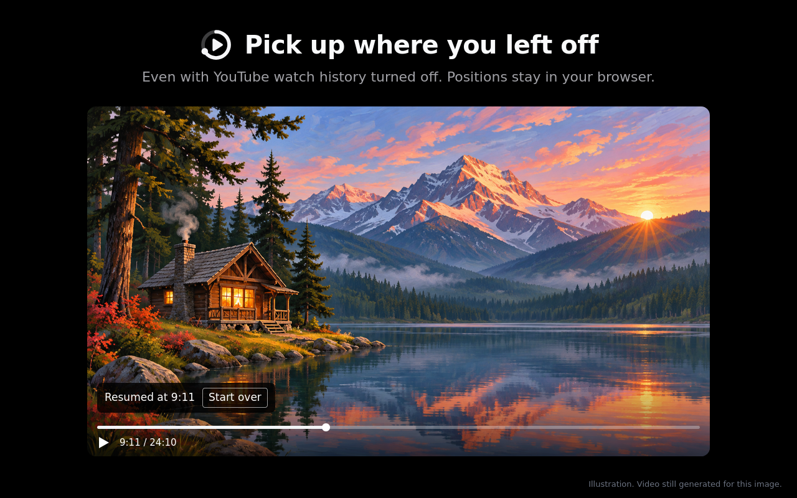
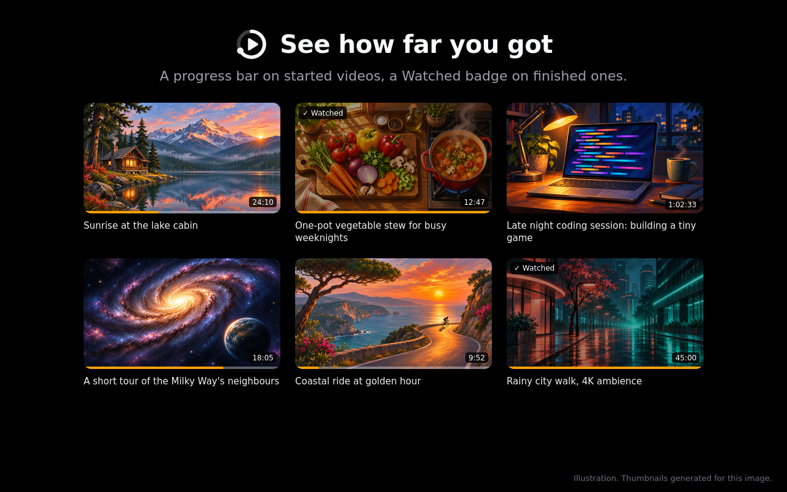

# Resume Position for YouTube

**A Firefox and Chrome extension that resumes YouTube videos where you left off, even with YouTube watch history turned off.**

[Install from Firefox Add-ons](https://addons.mozilla.org/firefox/addon/resume-position-for-youtube/) · [Türkçe](README.tr.md)

YouTube only remembers your playback position when watch history is on. If you keep history off for privacy, every video starts from 0:00 again. This add-on remembers the position locally, in your browser, and nowhere else.



## Features

- **Resume where you left off.** Reopen a video from anywhere (home, search, recommendations, a link) and it continues from the saved point. A short notice shows the time, with a **Start over** button.
- **Progress on thumbnails.** Search results, recommendations and channel pages show a progress bar on videos you started and a **Watched** badge on the ones you finished.
- **Finished videos start over.** A video closed near its end counts as watched and starts from the beginning next time.
- **Links with a time win.** `&t=` / `#t=` links play from the time in the link.
- **Your saved videos, listed.** The settings page lists saved videos by title and channel, with search, and lets you delete one or all of them.
- **Settings:** how long positions are kept (30 days to forever), the shortest video to remember, when a video counts as watched, the resume notice, thumbnail marks and their color.
- **Backup and restore** as a plain JSON file, for example to move to another computer.
- In English, Turkish, German, French, Spanish, Portuguese and Russian.

It leaves alone: ads, hover previews, live streams, Shorts, short videos (under 90 s by default), YouTube Music, embedded players and private windows.



## Privacy

- Positions (video ID, title, channel name, time, duration) are stored in the add-on's local storage (`storage.local`) on your computer.
- The add-on makes **no network requests**: no analytics, no sync, no account, no remote code.
- Entries you haven't opened for 90 days are deleted (adjustable). Uninstalling the add-on deletes everything.
- Permissions: `storage` and access to `www.youtube.com` only.

## Frequently asked

**Does it work with watch history paused?** Yes, that is what it is for. It doesn't read or change your YouTube history.

**Does it sync between computers?** No, on purpose. Use *Download backup* and *Restore from backup* to move positions.

**Chrome?** Yes: the same code is packaged for Chrome (111+) by `npm run build:chrome`. The Chrome Web Store listing is in preparation.

## Development

```sh
npm install
npm test                                   # decision logic (Node)
npm run lint                               # web-ext lint
npm start                                  # web-ext run on youtube.com
FIREFOX_BIN=/path/to/firefox npm run e2e   # 17 scenarios against real YouTube
npm run build                              # package into web-ext-artifacts/
npm run build:chrome                       # Chrome package: dist/chrome/ and a zip in web-ext-artifacts/
CHROME_BIN=/path/to/chrome npm run e2e     # the same 17 scenarios in Chrome (tests dist/chrome)
```

Firefox is the source of truth. `chrome/build.mjs` copies the sources and adapts them for Chrome: a service worker
instead of an event page, PNG icons that follow the browser's light or dark mode, a `browser` alias for `chrome`, and a
separate copy of `logic.js` for the page world (Chrome injects a file only once per frame).

Code layout:

| File | Role |
|---|---|
| `src/page.js` | Runs in the page; watches the YouTube player, saves and restores the position. |
| `src/bridge.js` | Content script that owns storage and answers `page.js`. |
| `src/thumbs.js`, `src/thumbs.css` | Progress bars and Watched badges on thumbnails. |
| `src/logic.js` | Pure decision logic, shared by all scripts and the tests. |
| `src/background.js` | Toolbar button opens the settings page. |
| `options/` | Settings page. |
| `amo/` | Store listing text, screenshots and a script for the AMO API. |
| `chrome/` | Chrome build script, Chrome-only files and Chrome Web Store listing. |

Bug reports and ideas: [issues](https://github.com/aliyusufergin/resume-position-for-youtube/issues).

## License

[MIT](LICENSE)
